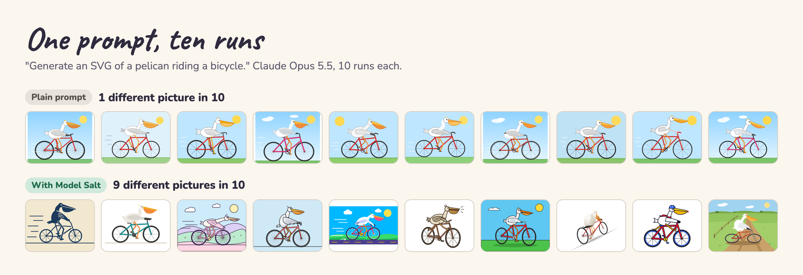

# Model Salt

Ask a language model for the same thing ten times and you get the same answer ten times. Model Salt is an MCP server that gives your model randomness from outside it, so one prompt gives ten different answers that still do exactly what you asked.

[](https://www.npmjs.com/package/@modelsalt/model-salt) [](https://github.com/modelsalt/model-salt/blob/main/LICENSE)

[modelsalt.com](https://modelsalt.com) · works in Claude Code, Codex, Gemini CLI and Kimi Code



## Install

One command adds it to your client. Run it once.

| Client | Command |
|---|---|
| Claude Code | `npx -y @modelsalt/model-salt setup claude` |
| Codex | `npx -y @modelsalt/model-salt setup codex` |
| Gemini CLI | `npx -y @modelsalt/model-salt setup gemini` |
| Kimi Code | `npx -y @modelsalt/model-salt setup kimi` |

Start a new session in your client after it, and the `model_salt` tool is there.

- **What it adds:** the `model-salt` server in your client's MCP list. For Codex and Kimi Code it also adds a short skill at `~/.agents/skills/model-salt/` that tells the model when to call the tool, and for Codex one setting on that server so the model sees the tool from the start.
- **Gemini CLI** runs local servers only in folders you trust.
- **See first:** add `--dry-run` to print what it would change and change nothing.
- **Run it twice:** nothing changes the second time.

## Undo

```sh
npx -y @modelsalt/model-salt uninstall claude    # or codex, gemini, kimi
```

It takes out everything `setup` added. The skill stays while another client of yours still uses it. `--dry-run` works here too.

## Use it

Ask for anything with room for choices: a picture, an SVG, a page, a name, a story, a plan. The model calls `model_salt` with your request, gets back what to settle this time, and then does your request as you asked it.

Want more or less of it? Say so in your prompt ("make it really different", "keep it close to the usual"). The tool takes a setting from 0 to 2. Left out, it is 1.

| Setting | How often each choice keeps the model's usual pick (target) |
|---|---|
| 0 | always |
| 0.5 | 70% of the time |
| 1 (default) | 45% of the time |
| 1.5 | 25% of the time |
| 2 | no more often than any other fitting pick |

The model skips the tool for questions with one right answer (a sum, a fact, a bug fix).

## What it changes

Same prompt, 10 runs each, from the examples on [modelsalt.com](https://modelsalt.com).

**"Generate an SVG of a pelican riding a bicycle."** Different pictures in 10 runs:

| Model | Plain prompt | With Model Salt |
|---|---|---|
| Claude Opus 5.5 | 1 | 9 |
| Claude Fable 5.1 | 3 | 9 |
| GPT-6.1 Sol | 2 | 10 |
| GPT-6 Astra | 1 | 8 |
| Gemini 4 Argon | 2 | 10 |
| Kimi K3 | 1 | 9 |

**"Suggest a name for a neighbourhood coffee shop."** Claude Opus 5.5, the first five runs:

| Plain prompt | With Model Salt |
|---|---|
| The Common Grind | The Footbridge |
| Common Ground | Brew Espresso Bar |
| The Common Grind | Snugwick Corner |
| The Daily Grind & Gather | Old Oak's |
| The Common Cup | Hilltop Coffee |

**"Write the first line of a short story about a lighthouse keeper."** Claude Opus 5.5:

- **Plain, 5 of 5 runs:** "For thirty-one years, Elias Marrow had kept the light burning for ships that never..." (Marrow, Maren or Marsh, thirty-one or forty-one years)
- **With Model Salt:** "The sea has gone perfectly still, and I have never been more afraid." / "The beam swept the black water again, lighting nothing Tomas had ever loved." / "Halfway up the iron stair with a can of whale oil knocking against her knee, Agnes Merrow..."

Every run, plain and salted, is in [`examples/`](https://github.com/modelsalt/model-salt/tree/main/examples), with the prompt, the model and the answer.

## What it needs

- **Node 18 or later.** `npx` fetches the package the first time.
- **Claude Code or Codex, signed in.** Each call runs one short extra request on your machine, on your own plan, with no API key: through Codex when you use Codex, and through Claude Code (Claude Opus 5.5) when you use Claude Code, Gemini CLI or Kimi Code. If that request can't run, the tool says so and your model carries on with the request as asked.
- **Time and tokens.** A salted answer takes longer and uses more tokens than a plain one. On the pelican prompt, Claude Opus 5.5 used about 3,300 more output tokens per answer.
- **Network.** The server fetches random bytes from public randomness sources (atmospheric and quantum noise, and the drand beacon). Your prompt is not sent to them. Offline, it uses your computer's own random generator.

## Other ways to run it

- **Short name:** `npx -y model-salt <args>` runs the same package as `npx -y @modelsalt/model-salt <args>`.
- **As a plugin:** `plugin/` holds a Codex plugin, a Claude Code plugin and a Gemini CLI extension, and this repo is a plugin marketplace. From a clone:
  - Codex: `codex plugin marketplace add /path/to/model-salt`, then `codex plugin add model-salt@model-salt`
  - Claude Code: `claude plugin marketplace add /path/to/model-salt`, then `claude plugin install model-salt@model-salt`
  - Gemini CLI: `gemini extensions install /path/to/model-salt/plugin`
- **By hand:** add a stdio MCP server that runs `npx -y @modelsalt/model-salt anthropic` (Claude, Gemini and Kimi models) or `npx -y @modelsalt/model-salt openai` (GPT models).
- **From a clone:** `node src/stdio.mjs anthropic` in place of the `npx` command.

## How it works

In a separate short run, the model names the biggest open decisions in your request (the questions an expert would ask) and a range of answers to each, its usual one included. Randomness from outside the model picks one answer per question. Your model then does the request with those answers settled. More, and why simpler ways failed: [docs/how-it-works.md](https://github.com/modelsalt/model-salt/blob/main/docs/how-it-works.md).

## Contributing

Found a prompt that still gives the same answer every time with Model Salt? [Open an issue](https://github.com/modelsalt/model-salt/issues) with the prompt, the model and a few runs. How to test a change to a family's steps: [CONTRIBUTING.md](https://github.com/modelsalt/model-salt/blob/main/CONTRIBUTING.md).

## Licence

- **Code:** MIT, see [LICENSE](https://github.com/modelsalt/model-salt/blob/main/LICENSE).
- **Example runs and pictures** (`examples/`, the images in `docs/`): CC BY 4.0, credit "Model Salt", see [examples/LICENSE](https://github.com/modelsalt/model-salt/blob/main/examples/LICENSE).
- **Word list** (`src/words.mjs`, Webster's 2nd, 1934): public domain.

Model Salt is a project by [Chris Benjaminsen](https://chrisbenjaminsen.com).
